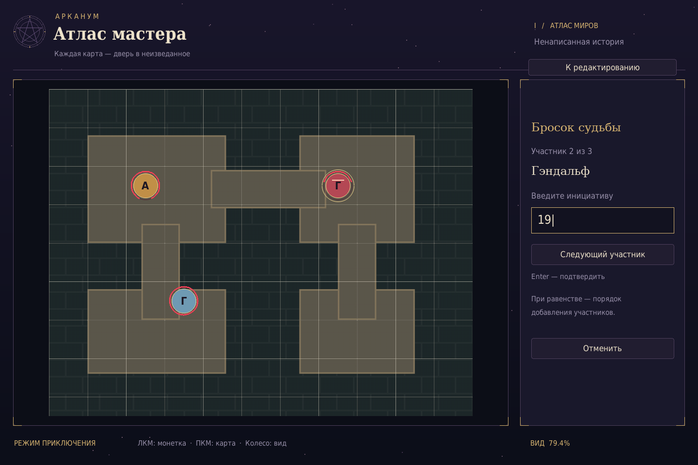
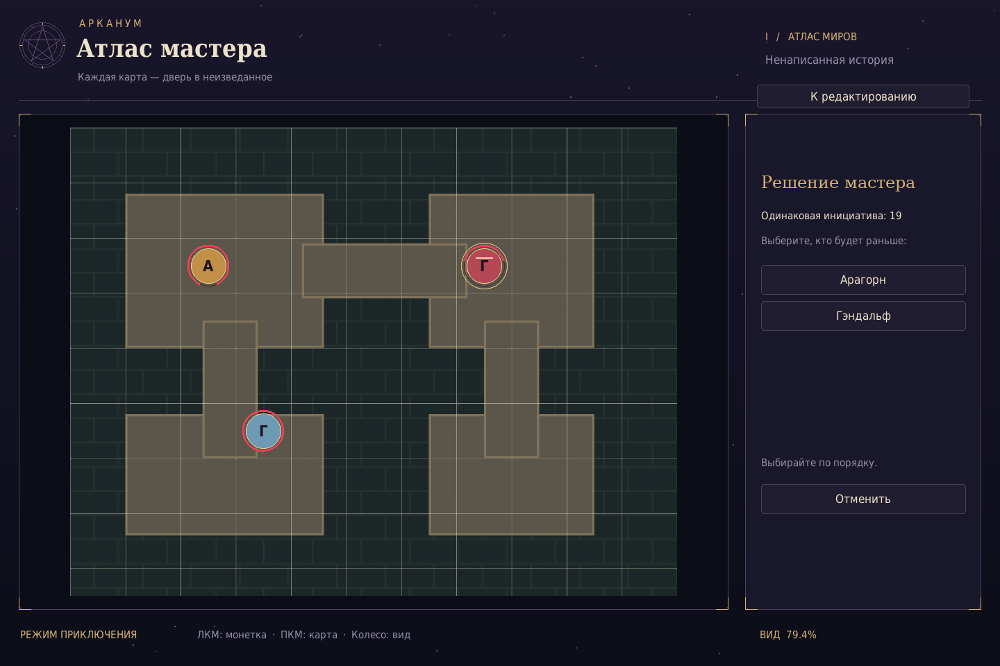
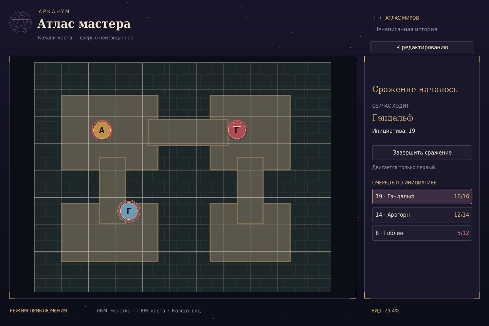

# Арканум — Атлас мастера

Редактор карт D&D на Pygame 2.6.1. Звёздный фон, магические печати, лунные линии и золотое оформление.

Разделы справа: **Печати** — настройка сетки, **Карта** — управление видом и масштаб 1:1, **Гримуар** — справочник управления.

## Режим игры

Монетки имеют жирную букву имени и красное кольцо здоровья. Длина кольца равна доле текущих ХП; при потере здоровья кольцо открывается сверху, а оба конца дуги симметрично опускаются вниз; остаток здоровья расположен снизу. При 0 ХП красная дуга исчезает. Выбранная монетка выделена золотым внешним кольцом, активная в бою — мятным кольцом и мягким свечением вокруг фишки.

### Начало сражения

Добавьте участников и нажмите **«Начать сражение»**. Введите инициативу каждого по очереди и подтвердите Enter или кнопкой. Допустимы целые значения от −99 до 999; пустое значение не принимается. На последнем участнике кнопка **«Начать бой»** строит очередь по убыванию инициативы. При равной инициативе герой ходит раньше противника. Если равенство между героями, перед началом боя мастер выбирает их порядок: сначала нажмите на того, кто должен идти раньше, затем на следующего (последний определяется автоматически). Несколько групп равенства разрешаются по очереди. Равенство между противниками пока сохраняет порядок добавления.

Очередь видна справа. Двигаться может только активный участник, его фишка подсвечена мятным свечением. **«Завершить ход»** передаёт управление следующему по инициативе; после последнего участника очередь начинается заново, счётчик раунда увеличивается. Порядок, выбранный мастером, сохраняется между раундами. Атаки, автоматический пропуск существ при 0 ХП и ограничения скорости пока не реализованы.

Во время ввода инициативы и выбора порядка равных героев монетки неподвижны. **«Отменить»** возвращает свободное перемещение. **«Завершить сражение»** снимает ограничения, сохраняя персонажей и их позиции. Для изменения состава или возврата к редактору сначала завершите бой.





В форме создания выберите **Игрок** или **Противник**, укажите имя, текущие и максимальные ХП. Между полями можно переходить Tab / Shift + Tab. ХП — целые числа: максимум от 1 до 99999, текущие от 0 до максимума. В списке здоровье стоит справа от имени (`Игрок1 12/14`); длинные имена сокращаются. Противники отмечены подписью «Враг» и красной монеткой с дополнительной отметкой. Они добавляются и перемещаются по тем же правилам свободных клеток, что и игроки. Данные пока вводятся вручную; базы существ и заготовок ещё нет.

Подготовьте карту и сетку, затем нажмите **«Начать игру»** над правой панелью. Введите имя персонажа (до 40 символов) и нажмите **«Добавить персонажа»** или Enter. Цветная монетка появится в центре свободной полной клетки поблизости от текущего вида. Без карты или свободных клеток персонаж не добавляется.

Перетаскивайте монетку ЛКМ на свободную клетку. При недопустимом перемещении она остаётся на прежнем месте. ПКМ двигает карту, колесо масштабирует вид. Список справа прокручивается колесом; нажатие на имя показывает персонажа в центре вида. Настройка сетки в игре отключена. **«К редактированию»** возвращает настройки карты.

Персонажи хранятся только в текущем сеансе. Загрузка другой карты в редакторе очищает список. Ограничений скорости, очередности ходов и проверки препятствий пока нет.

## Запуск

Нужен Python 3.10+.

```bash
python -m venv .venv
source .venv/bin/activate
# Windows: .venv\Scripts\activate
python -m pip install -r requirements.txt
python main.py
```

Перетащите изображение из проводника в окно или запустите `python main.py "карта.png"`.
Поддерживаются PNG, JPEG, BMP и другие форматы установленного SDL_image.

| Действие | Управление |
| --- | --- |
| Сдвинуть сетку относительно карты | Зажать ЛКМ и тянуть |
| Размер ячеек | Колесо или − / + на панели |
| Точная настройка ячеек | Shift + колесо или перетаскивание числа размера |
| Особо точная настройка | Shift + перетаскивание числа (0.01 px на логический пиксель движения) |
| Закрепить / открепить сетку | Кнопка «Закрепить печать» или L |
| Сдвинуть карту вместе с сеткой | Зажать ПКМ или среднюю кнопку |
| Масштаб вида под курсором | Ctrl + колесо |
| Квадраты / шестигранники | Панель или 1 / 2 |
| Скрыть сетку | Панель или G |
| Вписать карту в окно | Панель или F |
| Сбросить размер и смещение сетки | Панель или R |
| Выход | Escape |

Размер и смещение сетки заданы в пикселях исходной карты: при зуме сетка остаётся привязанной к изображению. Для гексов размер означает полную ширину ячейки. При слишком мелком масштабе сетка временно скрывается. Новая карта сбрасывает размер и смещение. Исходные изображения не изменяются; настройки пока хранятся только до закрытия окна.

Размер ячеек и масштаб вида меняются плавно, с дробной точностью и сглаженными линиями. Закреплённая сетка защищена от сдвига, изменения размера, типа и сброса. Перемещение и масштабирование самой карты, цвет и видимость линий остаются доступны. Загрузка другой карты снимает фиксацию.

## 4K и чёткость

Разверните окно обычной кнопкой ОС. Приложение рисует интерфейс сразу в разрешении окна, включая 3840 × 2160, без растягивания промежуточного кадра. Шрифты пересоздаются под размер окна, геометрия рисуется заново. В Windows до создания окна включается Per-Monitor DPI Awareness, чтобы избежать размытия от системного масштабирования. После обновления полностью перезапустите приложение.

Чёткость самой карты зависит от исходного изображения: увеличение маленького JPEG не добавляет ему деталей. «Карта → Исходный размер» показывает изображение в масштабе 1:1.

Проверка без графического рабочего стола: `python -m unittest discover -s tests -v`.
